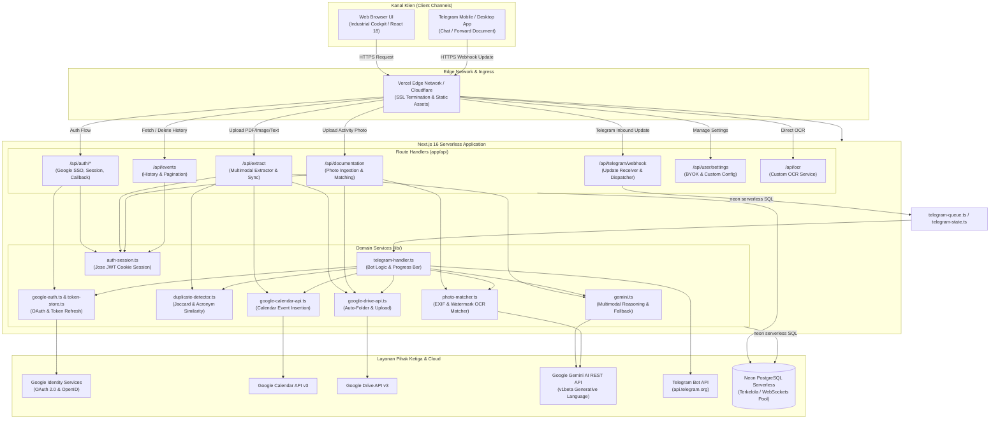
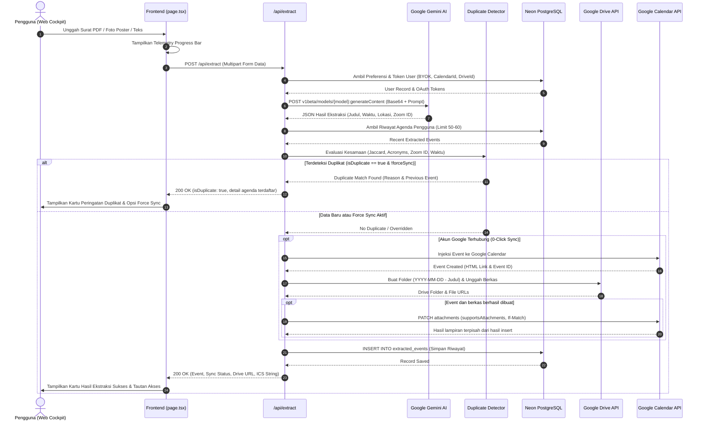
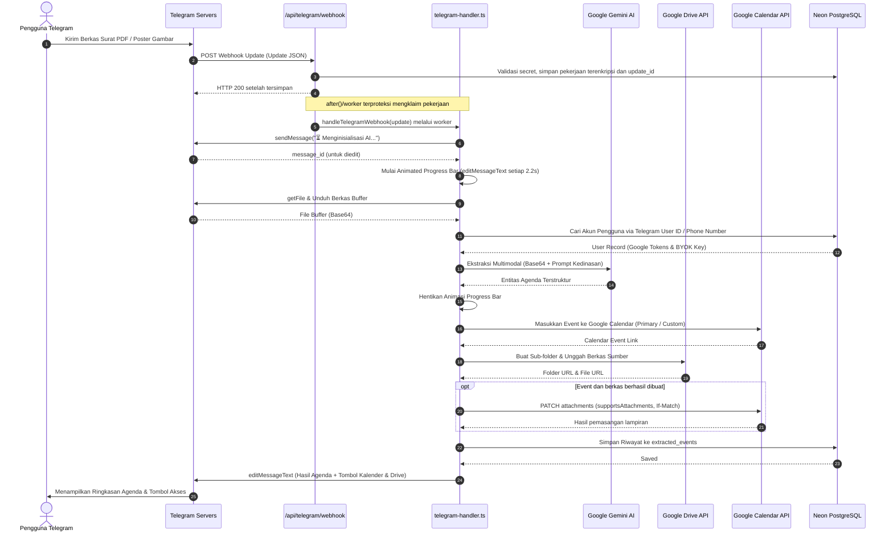
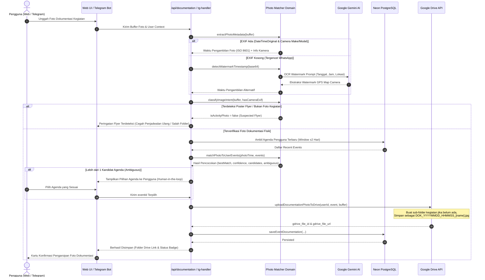

# System Architecture Document
## EasyCal // Serverless OCR & Gemini Calendar Studio

### Jalur bot P0/P1 (v1.3.0)

- `telegram-webhook.ts` memvalidasi secret header, menerima bot melalui identitas hash, menyimpan update terenkripsi, lalu merespons 200. Kegagalan penyimpanan menghasilkan 503 agar pengiriman bisa diulang Telegram. Token/kunci dari query tidak digunakan untuk otorisasi.
- `telegram-state.ts` menyimpan payload AES-256-GCM dan versi CAS di Neon; `telegram-queue.ts` mengelompokkan album, membatasi kuota, mengklaim lease pekerjaan/chat, serta memulihkan pekerjaan terputus maksimal tiga kali. JSON lokal hanya untuk pengembangan. `after()` menargetkan pekerjaan update yang baru diterima. Pemicu internal terautentikasi melanjutkan job tertahan/retry dan backlog berikutnya; cron/worker eksternal tetap menjadi cadangan saat handoff gagal.
- `telegram-security.ts` mengelola akses setup pemilik/admin, secret webhook, binding Telegram dan OAuth state sekali pakai yang terikat cookie. Pengaturan web tidak bisa mengubah identitas Telegram, dan endpoint status/unggahan memakai identitas sesi. Penautan Google baru melepas akun lama dengan transaksi dan advisory lock.
- `telegram-workflows.ts` menyimpan pilihan foto/album, pratinjau perubahan, konfirmasi, snapshot undo, serta pemulihan sumber/lampiran. Setiap aksi terikat pengguna/chat/bot/pemilik dan kedaluwarsa. Jadwal diklaim bersama nilai baru; riwayat mencatat semula → menjadi. Sumber revisi diunggah dan dilampirkan sesudah konfirmasi tanpa mengganti event/folder lama.
- `telegram-context.ts` memberi identitas operasi per pekerjaan. Calendar memakai ID insert stabil dan pemulihan konflik 409; Drive memakai `appProperties` untuk mencari ulang hasil operasi. Riwayat/foto memakai ID stabil. Perlindungan ini tidak membentuk transaksi atomik lintas layanan eksternal.
- Ekstraksi tidak mengganti waktu mulai yang kosong dengan besok. Bot meminta pelengkapan/konfirmasi; web mengembalikan `requiresConfirmation` tanpa sinkronisasi/ICS/riwayat. `/status cek` memeriksa akses baca layanan, bukan membuat event.

Kontrak, retensi, perintah, batas hosting, dan migrasi operasional dijelaskan di [Telegram.md](Telegram.md).

### Lint dan pemeriksaan repositori

`npm run lint` menjalankan ESLint CLI dengan flat config `eslint.config.mjs` dan preset `eslint-config-next/core-web-vitals` versi yang selaras dengan Next.js 16.3.4. Parser preset mendukung JavaScript/TypeScript; pemeriksaan tipe penuh tetap melalui `npm run typecheck`. CI menjalankan lint sebelum tes/build. Build, dependencies, context lokal, cache, serta percobaan lokal dikecualikan; tes regresi dan worker tetap diperiksa.

Inisialisasi sesi memperbarui state setelah respons jaringan dan mengabaikan respons setelah komponen dilepas. Pemuatan riwayat memiliki callback stabil, pembatalan request awal, serta pemeriksaan nomor request untuk respons yang datang terlambat. Pembungkus event handler menandai loading sebelum pemuatan manual; waktu peringatan dialog pemulihan diambil saat dialog dibuka. Perubahan ini menyelesaikan temuan Hooks/purity tanpa mematikan aturan lint.

ESLint 9 dipakai karena plugin React bawaan konfigurasi 16.3.4 gagal pada ESLint 10 (`context.getFilename`). npm memberi peringatan masa dukungan versi 9; upgrade tooling berikutnya perlu menyelaraskan plugin. Instalasi dan audit dependensi tidak otomatis menjadi perintah memperbarui framework atau menjalankan audit fix --force.

---

## 1. System Overview & Architectural Principles

**EasyCal** dibangun di atas fondasi arsitektur **Serverless Modern**, mengutamakan performa tanpa server fisik (*zero-maintenance infrastructure*), skalabilitas tinggi di tepi jaringan (*edge/serverless compute*), keamanan data terisolasi per pengguna (*multi-tenant BYOK isolation*), serta modularitas kode yang bersih.

### Prinsip Utama Arsitektur:
1. **Stateless Compute**: Seluruh endpoint API dijalankan sebagai Serverless Functions (Next.js App Router di Vercel), tidak menyimpan state di memori proses lokal.
2. **Decoupled Integrations**: Layanan Google APIs (Calendar, Drive, OAuth), AI Engine (Google Gemini), Telegram Bot API, dan Basis Data (Neon PostgreSQL) dihubungkan melalui modul adapter independen di direktori `lib/`.
3. **Multi-Tier Fault Tolerance**: Rantai fallback berlapis untuk pemanggilan AI Gemini (multi-model fallback), kegagalan perizinan folder Google Drive (fallback ke root drive), dan ketersediaan database (fallback ke local cache store).
4. **Sub-second Client Telemetry**: Frontend menyajikan respons visual instan dengan umpan balik telemetri dinamis untuk setiap tahapan pemrosesan AI yang intensif.

---

## 2. High-Level System Architecture Diagram



---

## 3. Technology Stack Breakdown

| Komponen / Lapisan | Teknologi / Pustaka | Versi | Justifikasi Pemilihan |
|---|---|---|---|
| **Framework Web & API** | Next.js (App Router) | `16.3.4` | Serverless route handlers, optimasi bundle, arsitektur hybrid SSR/CSR. |
| **Pustaka Antarmuka** | React & React-DOM | `18.3.1` | Manajemen state reaktif, rendering komponen cepat. |
| **Bahasa Pemrograman** | TypeScript | `5.6.3` | Type safety ketat, antarmuka kontrak data yang jelas. |
| **Sistem Desain & Gaya** | Vanilla CSS (Bespoke Tokens) | CSS3 | Tanpa overhead utilitas eksternal (no-Tailwind), kontrol estetika *Industrial Cockpit* presisi. |
| **Basis Data Cloud** | `@neondatabase/serverless` | `1.1.0` | Driver serverless berbasis HTTP/WebSocket tanpa batas koneksi pooler Postgres tradisional. |
| **Google Cloud SDK** | `googleapis` | `178.0.0` | Klien resmi untuk Google Calendar v3, Google Drive v3, dan OAuth2. |
| **Otentikasi & Sesi** | `jose` | `6.2.10` | Enkripsi dan verifikasi JWT aman, kompatibel dengan Edge runtime. |
| **Manipulasi Tanggal/Waktu**| `luxon` | `3.5.0` | Penanganan zona waktu IANA (`Asia/Jakarta`, UTC+7) dan kalkulasi durasi presisi. |
| **Parser EXIF Citra** | `exifr` | `7.1.3` | Ekstraksi cepat metadata EXIF citra (DateTimeOriginal, Make, Model, GPS) murni di sisi server. |
| **Ikonografi UI** | `lucide-react` | `0.453.0` | Ikon SVG bergaya teknis, ringan, dan tree-shakeable. |
| **Infrastruktur Hosting** | Vercel Serverless | Platform | Deploy otomatis dari Git, auto-scaling global, sertifikat SSL instan. |

---

## 4. Application Layer Breakdown

### 4.1 Presentation Layer (`app/page.tsx`, `app/globals.css`)

`app/AppFooter.tsx` digunakan pada halaman utama sebelum/sesudah login dan halaman changelog. Nomor versi diimpor dari package.json sehingga footer mengikuti versi paket tanpa konstanta versi tambahan. `/changelog` adalah halaman server publik (`app/changelog/page.tsx`) yang membaca CHANGELOG.md saat render/build, mengelompokkan rilis/kategori menggunakan parser `lib/changelog.ts`, lalu menampilkan elemen React. Teks tidak disisipkan sebagai HTML mentah. Header rilis, tanggal, kategori, serta daftar bullet bersumber dari Markdown yang sama dengan dokumentasi repository; setelah catatan diubah, deployment perlu dibangun ulang.

Dashboard memakai kolom `minmax(0, ...)` agar ukuran minimum konten tidak memperlebar halaman. Kelas CSS untuk banner Telegram, spesifikasi kegiatan, lokasi, dan pagination mengatur pembungkusan konten secara terarah. Pada mobile hingga 640px, pemilih sumber memakai grid 2×2, tautan bot memakai label singkat, filter ditumpuk, dan header/profil dapat membungkus. Scroll horizontal hanya dipertahankan pada navigasi utama, bukan dengan memotong overflow seluruh halaman.
* **Single-Page Cockpit View**: Arsitektur dashboard satu halaman terpadu dengan navigasi tab reaktif:
  * Tab `extract`: Workspace ekstraksi terbagi dua kolom (*split-viewport*): zona input (PDF, Gambar, Teks) dan panel telemetri hasil ekstraksi.
  * Tab `settings`: Panel manajemen kredensial pengguna (BYOK API Key, Target Calendar, Drive Root Folder, Telegram Token).
  * Tab `telegram`: Konfigurasi panduan bot, status webhook, dan tombol utilitas pengujian bot.
  * Tab `docs`: Dokumentasi operasional dan integrasi sistem.
* **Telemetry Progress Animation**: Visualisasi dinamis dari tahapan pemindaian dokumen hingga sinkronisasi kalender selesai.
* **Client-Side Storage Fallback**: Menyinkronkan konfigurasi formulir dengan respon sesi server `/api/auth/me`.

### 4.2 API & Routing Layer (`app/api/`)
* **`/api/auth/google`**: Mengenerasi URL otorisasi Google OAuth 2.0 dengan parameter `access_type=offline` dan `prompt=consent` untuk menjamin penerbitan `refresh_token`.
* **`/api/auth/callback`**: Menangkap kode otorisasi dari Google, menukarkannya dengan token, mengambil profil pengguna, memperbarui database, dan membuat JWT cookie sesi.
* **`/api/auth/me`**: Memvalidasi sesi JWT pengguna saat ini dan mengembalikan profil serta pengaturan pengguna.
* **`/api/auth/logout`**: Menghapus cookie sesi HTTP-only.
* **`/api/extract`**: Endpoint sentral penanganan dokumen (multipart/form-data atau JSON). Mengekstrak entitas via Gemini, memeriksa duplikasi, mengunggah arsip ke Google Drive, menginjeksi ke Google Calendar, dan mencatat riwayat.
* **`/api/events`**: Layanan CRUD riwayat agenda pengguna dengan dukungan paginasi (`GET`) dan penghapusan item (`DELETE`).
* **`/api/telegram/webhook`**: Handler webhook yang menerima update dari Telegram API secara asinkron.
* **`/api/telegram/setup`**: Endpoint utilitas untuk memeriksa informasi webhook (*getWebhookInfo*), memasang URL webhook (*setWebhook*), dan menghapus webhook (*deleteWebhook*).
* **`/api/user/settings`**: Memperbarui setelan kredensial per pengguna di database.
* **`/api/ocr`**: Endpoint langsung untuk pemrosesan OCR teks mentah.
* **`/api/documentation`**: Endpoint khusus penanganan foto dokumentasi kegiatan fisik. Menerima multipart/form-data foto, mengekstrak EXIF/watermark waktu, mencocokkan secara otomatis ke agenda pengguna yang relevan, mengunggah ke sub-folder Google Drive kegiatan terkait, dan mencatat relasi di basis data tanpa membuat agenda kalender baru. Mendukung query param `eventId` untuk mengambil riwayat foto kegiatan.

### 4.3 Domain & Business Logic Layer (`lib/`)

#### `photo-matcher.ts` (Mesin Pencocokan Foto & Filter Guardrail)
* **Ekstraktor EXIF Serverless (`extractPhotoMetadata`)**: Menggunakan `exifr` untuk mengekstrak `DateTimeOriginal`, `Make`, `Model`, `latitude`, `longitude`. Menerjemahkan zona waktu lokal ke format ISO 8601 UTC+7.
* **Fallback OCR Watermark Vision (`detectWatermarkTimestamp`)**: Memanggil Gemini Vision jika metadata EXIF hilang (misal akibat kompresi WhatsApp) untuk membaca stempel tanggal, jam, dan lokasi dari aplikasi seperti *GPS Map Camera* atau *Timestamp Camera*.
* **Guardrail Anti-Poster Flyer (`classifyImageIntent`)**: Memeriksa keberadaan EXIF hardware kamera asli. Jika tidak ada EXIF kamera, sistem menjalankan klasifikasi AI cepat guna memastikan gambar bukan poster flyer acara / surat dinas, mencegah salah penempatan berkas.
* **Pencocok Temporal Berbobot (`matchPhotoToUserEvents`)**: Mencocokkan waktu foto terhadap rentang waktu kegiatan pengguna (`start_time - 1 jam` s.d. `end_time + 2 jam`). Memberikan confidence score tinggi jika waktu berada di tengah kegiatan, serta menandai `ambiguous = true` bila ada lebih dari satu agenda yang berdekatan untuk konfirmasi pengguna (human-in-the-loop).

* **Validasi Waktu & Fallback OCR**: `parseWatermarkTimestamp` memvalidasi tanggal, jam, dan offset tanpa membuat jam default. `resolvePhotoTimestamp` mengembalikan waktu EXIF/watermark valid atau null. OCR mencoba model pengguna lalu rantai cadangan yang sama dengan ekstraksi agenda, dengan timeout delapan detik per model; HTTP 404/429/503 mencoba model berikutnya, sedangkan kegagalan izin dihentikan.
* **Pengarsipan Berdasarkan Bukti**: Telegram dan /api/documentation menghentikan pencocokan otomatis jika waktu foto tidak ada. Satu kandidat dengan score minimal 0,85 diperlukan untuk auto-filing; score 0,65 karena tanggal sama hanya menjadi saran. Beberapa kandidat berdekatan ditandai ambiguous dan memerlukan pemilihan manual. Telegram tidak membuat folder terpisah ketika tidak ada kecocokan.
* **Waktu Manual Tidak Diketahui**: Web mengizinkan eventId pilihan manual tanpa bukti waktu. Respons menyertakan captureTime: null, metadata taken_at disimpan kosong, dan waktu unggah hanya dapat dipakai untuk prefix nama berkas. UI tidak menampilkannya sebagai waktu pengambilan. Album foto Telegram dikumpulkan dalam satu pekerjaan dan satu pilihan tujuan/ringkasan; caption poster diprioritaskan.

#### `gemini.ts` (Mesin Multimodal & Normalisasi Data)
* **Prompt Engineering Terstruktur**: Prompt sistem berbasis panduan ketat tata kelola dokumen kedinasan Indonesia (Kop surat, nomor dinas, penentuan durasi default 2 jam jika 's.d. selesai', ekstraksi Meeting ID & Passcode Zoom, serta bobot JP).
* **Parser JSON Kebal Anomali (`parseGeminiJson`)**: Menghilangkan code fence markdown (` ```json `), serta membersihkan teks tambahan dengan ekstraksi regex objek terluar.
* **Normalisator Tanggal & Event (`normalizeCalendarEvent`)**: Memvalidasi tanggal ISO 8601, memastikan tanggal selesai tidak mendahului tanggal mulai, dan merapikan string lokasi.
* **Fallback Rantai Model**: Menginisialisasi request berurutan ke model `gemini-3.6-flash` -> `gemini-3.5-flash` -> `gemini-3.1-flash-lite` jika terbentur kuota (HTTP 429) atau keterbatasan kapasitas (HTTP 503).

#### `duplicate-detector.ts` (Sistem Anti-Duplikasi Cerdas)
* **Pembersihan Token & Stop-words**: Memfilter kata penghubung birokrasi yang umum (*dan, di, ke, perihal, sehubungan, bapak, ibu, yth*).
* **Ekspansi Akronim Dinas**: Mengonversi istilah singkatan ke bentuk panjang menggunakan peta kamus administrasi.
* **Multi-Metric Scoring**:
  * $Jaccard(A, B) = \frac{|A \cap B|}{|A \cup B|}$
  * $Containment(A, B) = \frac{|A \cap B|}{\min(|A|, |B|)}$ (menilai kesamaan judul singkatan vs judul lengkap).
  * $Dice(A, B) = \frac{2 \times |Bigrams(A) \cap Bigrams(B)|}{|Bigrams(A)| + |Bigrams(B)|}$ (toleransi kesalahan ketik).
* **Pencocokan Meeting ID Zoom & Meet Code**: Normalisasi ID Zoom numerik 9–11 digit dan format kode Meet (`xxx-yyyy-zzz`).

#### `google-drive-api.ts` (Manajemen Pengarsipan Google Drive)
* **Pembuatan Folder Kronologis**: Membuat folder `YYYY-MM-DD - [Judul Kegiatan]` di bawah folder induk pilihan pengguna.
* **Streaming Upload**: Mengunggah buffer dokumen menggunakan `Readable Stream` untuk efisiensi memori runtime serverless.
* **Konversi Transkrip Teks**: Jika sumber masukan berupa teks obrolan, sistem menghasilkan dokumen teks berformat resmi (`salinan_undangan.txt`) dan mengunggahnya ke Google Drive.
* **Pengunggahan Foto Dokumentasi (`uploadDocumentationPhotoToDrive`)**: Memastikan sub-folder kegiatan tersedia (membuat folder baru bila agenda belum memilikinya), memberi prefix nama berkas `DOK_YYYYMMDD_HHMMSS_[nama].jpg`, dan mengunggah foto langsung ke sub-folder tersebut.
* **Fallback Resilient**: Jika folder induk yang ditentukan tidak dapat diakses (misal telah dihapus di Drive), sistem otomatis membuat folder di Root Drive pengguna tanpa menggagalkan proses kalender.

#### `google-calendar-api.ts` (Integrasi Kalender)
* **Autentikasi Otomatis via Refresh Token**: Memperbarui *access token* yang kedaluwarsa secara otomatis menggunakan event listener `tokens` dari OAuth2Client.
* **Konstruksi Deskripsi Kaya**: Menghasilkan deskripsi agenda terstruktur berisi nomor surat dinas, link meeting, kredensial akses, bobot JP, dan tautan folder Google Drive.

* **Orkestrasi Sumber (`syncGoogleCalendarEventWithSource`)**: Membuat event satu kali, mengarsipkan sumber ke Drive, lalu memasang lampiran hanya jika keduanya berhasil. Hasil memisahkan insertResult, gdriveResult, dan attachmentResult. Web menyertakan attachmentResult pada autoSyncResult; bot menampilkan hasilnya dalam balasan event.
* **Lampiran Drive (`attachDriveFileToCalendarEvent`)**: Membaca lampiran event, memeriksa berkas yang sama dan batas 25 lampiran, lalu PATCH hanya attachments dengan supportsAttachments: true, sendUpdates: none, dan If-Match ETag. fileId dipakai untuk pemeriksaan, bukan ditulis ke field attachment yang read-only. URL, judul, dan MIME berasal dari hasil unggahan Drive. Kegagalan tidak memicu insert ulang dan tidak mengubah izin berbagi file.
* **Metadata Unggahan**: Adapter Drive mengembalikan fileName dan mimeType aktual beserta fileId/fileUrl. Jika folder tersedia tetapi unggahan sumber gagal, hasil arsip success: false tetap menyertakan folderId/folderUrl dan pesan kegagalan. Event Calendar yang sudah dibuat dipertahankan.

#### `telegram-handler.ts` (Bot Telegram Terintegrasi)
* **Indikator tunggu AI**: Timer asinkron memperbarui pesan menunggu hasil AI tanpa persentase atau klaim tahap Calendar. Hanya satu edit berjalan; hasil akhir menunggu penghentian timer.
* **Verifikasi Kontak (Phone Binding)**: Memproses pesan kontak (`msg.contact`) untuk menyinkronkan identitas Telegram ID dengan nomor HP yang didaftarkan pengguna di dashboard web.
* **Handling Inline Keyboard & Direct Action**: Mengirim kartu hasil agenda dengan tombol langsung ke Google Calendar web dan Google Drive.

---

#### Pembaruan Kegiatan & Pemulihan Token

* **`event-update.ts`**: Mencocokkan satu kegiatan aktif berdasarkan judul/tanggal semula atau menerima ID dan versi dari sesi daftar Telegram. Memvalidasi perubahan parsial, mempertahankan nilai yang tidak disebutkan, dan menyimpan jadwal yang diinginkan pada record yang sama.
* **`event-lifecycle-store.ts`**: Memeriksa kepemilikan melalui ID akun/email/Telegram dan mengklaim versi secara atomik. Penyimpanan status sinkronisasi juga menyimpan `start_time`, `end_time`, dan `location`. Identitas Google dan folder dokumentasi tetap dipertahankan.
* **`event-lifecycle.ts`**: Sinkronisasi kegiatan aktif tanpa cadangan pembatalan melakukan PATCH start/end/location ke event Google yang sama. ETag diperiksa dengan If-Match. Kegagalan tercatat agar perintah `sinkron` dapat mencoba kembali; event dengan peserta undangan atau status terhapus tidak diperbarui otomatis.
* **`telegram-handler.ts`**: Meneruskan metadata `CalendarEvent.update` sebelum pemeriksaan duplikat. `/update <nomor>` menggunakan sesi daftar per bot/chat/pengguna/pemilik dengan masa berlaku 15 menit; ID dari sesi dapat dipilih meskipun tidak masuk 50 riwayat terbaru. Pilihan ambigu atau perubahan yang tidak terbaca tidak diteruskan ke inserksi agenda.
* **Penyelesaian Progress Telegram**: `startTelegramProgressBar` hanya menjalankan satu edit pada satu waktu. `stop()` bersifat asinkron, menghentikan timer dan menunggu edit yang masih berlangsung. Handler PDF/gambar/teks menunggu stop sebelum hasil akhir. `finishUpdateNotice` mengganti pesan progress untuk hasil update berhasil/gagal, dengan fallback ke pesan baru jika Telegram menolak edit termasuk percobaan tanpa Markdown.
* **`token-store.ts` & callback OAuth**: Database menjadi sumber utama token sebelum cache memori/KV/file. Login ulang menghapus alias cache akun terkait; callback menyimpan identitas Google dan refresh token efektif dari database.
* **`google-api-error.ts`**: Mengenali `invalid_grant` melalui pesan atau respons OAuth dan menyediakan petunjuk reconnect bersama untuk Drive dan Calendar. Kesalahan ini tidak memicu fallback pembuatan folder Drive di root. Tombol reconnect tersedia pada `/connect` meskipun akun masih terhubung.

Alur pembaruan: Telegram ? ekstraksi ? pencocokan ? pratinjau semula/menjadi ? konfirmasi pengguna ? klaim versi dan simpan jadwal ? PATCH Calendar ? arsip/lampiran revisi pada kegiatan yang sama. Folder lama tidak diganti namanya; folder dibuat jika kegiatan belum memilikinya.

## 5. Detailed Sequence Diagrams

### 5.1 Web Multimodal Extraction & 0-Click Sync Flow



### 5.2 Telegram Bot Ingestion & Auto-Drive Flow



### 5.3 Smart Photo Documentation Ingestion Flow



---

## 6. Security, Isolation & Multi-Tenancy Architecture

### 6.1 Isolasi Data Pengguna (Data Multi-Tenancy)
* Setiap pengguna diidentifikasi dengan kunci primer unik (`users.id`), yang dibentuk dari format Google ID (`google_123456789...`) atau Telegram ID (`tg_123456789...`).
* Seluruh kueri riwayat agenda (`extracted_events`) difilter secara ketat berdasarkan klausa `user_id = $userId`.
* API Key Google Gemini (BYOK) milik pengguna hanya digunakan untuk mengeksekusi request milik pengguna tersebut dan tidak pernah diekspos ke klien lain.

### 6.2 Siklus Hidup & Penyimpanan Token Google OAuth
* **Refresh Token Persistence**: Token penyegaran (`google_refresh_token`) disimpan di kolom terenkripsi pada tabel `users`.
* **Access Token On-Demand Refresh**: Sistem tidak mengandalkan masa aktif *access token* yang singkat (1 jam). Setiap kali interaksi Google API berlangsung, `oauth2Client` secara otomatis memperbarui *access token* jika sudah kedaluwarsa dan memperbarui nilai expiry di database melalui event callback `tokens`.

### 6.3 Perlindungan Sesi Web
* Menggunakan cookie bertanda tangan `easycal_session` yang dienkripsi menggunakan algoritma `HS256` via pustaka `jose`.
* Cookie dikonfigurasi dengan atribut:
  * `HttpOnly`: Mencegah akses token dari skrip JavaScript sisi klien (mitigasi XSS).
  * `Secure`: Diwajibkan hanya melalui koneksi terenkripsi HTTPS di lingkungan produksi.
  * `SameSite=Lax`: Melindungi sistem dari serangan pemalsuan permintaan lintas situs (*CSRF*).

---

## 7. Deployment & Infrastructure Strategy

### 7.1 Serverless Deployment di Vercel
* Proyek dikonfigurasi menggunakan berkas `vercel.json` dengan deklarasi alokasi waktu eksekusi:
  ```json
  {
    "framework": "nextjs",
    "functions": {
      "app/api/**/*": {
        "maxDuration": 60
      }
    }
  }
  ```
* `maxDuration: 60` detik adalah batas eksekusi hosting, bukan jaminan penyelesaian. Rangkaian generateContent dibatasi total 40 detik dan maksimal 25 detik per model; unduhan/OCR/database/Google tetap memakai waktu tambahan.

### 7.2 Konektivitas Basis Data Neon PostgreSQL
* Menggunakan pustaka `@neondatabase/serverless` yang berkomunikasi melalui protokol HTTP / WebSocket bawaan Neon.
* Menghindari masalah kehabisan batas koneksi (*connection exhaustion*) yang umum terjadi pada database PostgreSQL tradisional saat ratusan fungsi serverless berjalan bersamaan.

### Ketahanan ekstraksi Gemini (v1.3.1)

`gemini.ts` menerapkan anggaran 40 detik untuk fetch dan pembacaan respons generateContent, maksimum 25 detik per model dengan fallback sesuai sisa waktu (minimum 3 detik). HTTP 404/429/5xx mencoba model berikutnya; autentikasi/validasi berhenti. Penanda retry dibersihkan setelah sukses atau galat permanen. Log per percobaan hanya berisi model, durasi, status, outcome dan hash identitas operasi. Ini tidak membatasi seluruh jalur OCR/Google ke 40 detik.

`telegram-extraction.ts` membungkus ekstraksi PDF/poster/teks dan menyimpan hasil sukses beserta update sebelum dispatch. Kunci `ai-result` mencakup identitas operasi dan fingerprint pemilik/sumber; retensi terenkripsi tujuh hari. Retry pekerjaan tidak memanggil AI lagi setelah hasil berhasil disimpan. Cache `extraction` yang sudah ada tetap mempertahankan hasil agenda baru pada retry dispatch. Konteks worker membawa attempt dan managedRetry untuk pesan kegagalan sementara; handler memberi reply_parameters ke pesan asal untuk mengurangi ambiguitas hasil lama.

### Penjadwalan kelanjutan Telegram (v1.3.2)

telegramJobId dipakai bersama oleh penerimaan dan webhook. drainTelegramQueue(preferredJobId, resumeToken?) membaca job tujuan langsung, mempertahankan CAS/lease per chat dan job. Job yang belum selesai diserahkan ke continueTelegramJob; satu backlog due lain ikut dijadwalkan. Drain tanpa target tetap tersedia untuk scheduler dan melanjutkan retry job yang baru ditanganinya. Album terlambat yang menjadi singleton dipulihkan melalui pemindaian backlog.

telegram-queue-wake.ts menyimpan kapabilitas queue-wake per hash job: token acak sekali pakai, notBefore, validUntil, attempt dan hops. Origin berasal hanya dari NEXT_PUBLIC_APP_URL, HTTPS produksi, tanpa kredensial/redirect. Penerima POST worker memvalidasi scope/token/waktu dan CAS konsumsi, merespons 202, lalu after() menjalankan job atau invokasi tunggu. Replay tidak membuat after() kedua. Worker yang membawa token konsumsi boleh mengganti kapabilitas; trigger paralel lain ditekan selama kapabilitas masih aktif.

Satu invokasi tunggu maksimal 10 detik hanya melakukan handoff; AI memakai invokasi berikutnya. Batas 40 hop per attempt, 60 detik validitas token, dua upaya pengiriman per token dan timeout lima detik membatasi rantai. Metadata terenkripsi bertahan tujuh hari. Failure handoff tidak menghapus job; CRON_SECRET/scheduler eksternal diperlukan sebagai cadangan untuk crash/hop cap/domain terproteksi. Mekanisme berbasis after() tetap tunduk pada hosting, bukan layanan antrean terkelola dengan delivery guarantee.
