# Database Schema & Data Model Document
## EasyCal // Serverless Data Architecture & Contracts

### State Telegram P0/P1 — Unreleased

`telegram-state.ts` membuat tabel berikut secara idempoten ketika pertama kali dipakai. Database wajib untuk bot/OAuth produksi; kegagalan koneksi tidak dialihkan ke JSON lokal.

```sql
CREATE TABLE IF NOT EXISTS telegram_state (
  id TEXT PRIMARY KEY,
  kind TEXT NOT NULL,
  payload TEXT NOT NULL,
  version INTEGER NOT NULL DEFAULT 1,
  due BIGINT NOT NULL,
  expires BIGINT NOT NULL
);
CREATE INDEX IF NOT EXISTS telegram_state_due_idx ON telegram_state (kind, due);
```

`payload` adalah base64 dari IV 12 byte, ciphertext JSON, dan authentication tag 16 byte (AES-256-GCM; kunci SHA-256 dari SESSION_SECRET). `version` mendukung compare-and-swap, sedangkan `due`/`expires` adalah epoch milidetik. Kind meliputi bot, binding, oauth, job, lock, admission, quota, extraction, ai-result, status, action, notice, dan source-archive. Retensi dan kebijakan rotasi kunci ada di [Telegram.md](Telegram.md). Pengembangan tanpa database menggunakan `.telegram_state.json` yang diabaikan Git.

Job menyimpan update, kredensial bot terenkripsi, origin, status pending/processing/done/failed, attempts, leaseUntil dan receivedAt. Kunci job menggabungkan hash bot dengan update_id atau identitas album/chat. Action menyimpan pemilik, aktor, chat, bot, ID/versi kegiatan, snapshot sebelum/sesudah, referensi file Telegram atau teks, pilihan kandidat, lease dan status konsumsi. Biner unduhan tidak disimpan dalam action. `source-archive` menghubungkan metadata berkas revisi dengan kegiatan/pemilik selama satu tahun. Ini tidak mengubah format plaintext kredensial yang sudah ada pada tabel users.

`CalendarEvent` dapat memuat `validation_warnings: string[]` dan `needs_confirmation: boolean`; waktu tidak terbaca berupa string kosong dan tidak boleh disimpan sebagai event baru. API ekstraksi web mengembalikan `requiresConfirmation: true` untuk hasil tersebut, tanpa ICS, history atau auto-sync. `EventUpdate.end_date` mendukung snapshot undo lintas hari, dan clock menerima HH:mm atau HH:mm:ss. Riwayat lifecycle menyimpan uraian perubahan semula/menjadi pada reason. Event dan foto memakai ID stabil serta upsert metadata sinkronisasi untuk retry.

Setup webhook menerima POST `{ action, botToken? }` dengan sesi dan Origin yang valid. Token harus milik akun tersimpan atau admin terdaftar. URL webhook yang dikembalikan hanya memuat hash bot. Worker menerima Bearer CRON_SECRET. Parameter identitas pengguna dari body/header/query tidak mengotorisasi akses unggahan, dokumentasi atau status akun; identitas diambil dari sesi.

---

## 1. Database Overview & Engine

EasyCal menggunakan basis data **Neon PostgreSQL Serverless** yang terhubung melalui pustaka `@neondatabase/serverless`. Arsitektur ini dirancang untuk:
* **Serverless HTTP/WebSocket Connection Pool**: Menghilangkan batasan koneksi persisten Postgres konvensional pada runtime serverless (Vercel).
* **Auto-Schema Migration (`initDatabase`)**: Menjalankan migrasi DDL otomatis saat aplikasi pertama kali dieksekusi tanpa perlu perkakas CLI migrasi tambahan.
* **Dual-Layer Resilience**: Apabila variabel environment database (`DATABASE_URL` atau `POSTGRES_URL`) tidak terkonfigurasi, mode pengembangan dapat menggunakan JSON lokal. State antrean/OAuth produksi wajib memakai database dan menolak fallback ketika konfigurasi/koneksi gagal.

---

## 2. Entity-Relationship Diagram (ERD)

```mermaid
erDiagram
    USERS ||--o{ EXTRACTED_EVENTS : "owns / extracts"
    EXTRACTED_EVENTS ||--o{ EVENT_DOCUMENTATIONS : "stores documentation photos"
    
    USERS {
        VARCHAR(255) id PK "google_id / tg_id / email"
        VARCHAR(255) email UK "Alamat email unik pengguna"
        VARCHAR(255) name "Nama lengkap profil"
        TEXT picture "URL foto avatar Google"
        VARCHAR(50) phone_number "Nomor HP profil; kepemilikan dicek saat kontak Telegram"
        TEXT google_refresh_token "Token OAuth offline refresh"
        TEXT google_access_token "Token akses Google API sementara"
        BIGINT google_token_expiry "Timestamp kedaluwarsa token akses"
        TEXT gemini_api_key "Google Gemini API Key (BYOK)"
        TEXT telegram_bot_token "Token Bot Telegram kustom"
        TEXT telegram_chat_id "Chat ID Telegram pengguna"
        VARCHAR(255) calendar_id "Target Google Calendar (default: primary)"
        TEXT gdrive_root_folder_id "ID folder induk Google Drive"
        TEXT gdrive_root_folder_url "URL folder induk Google Drive"
        VARCHAR(50) ocr_engine "Engine OCR: gemini / ocr_service / hybrid"
        TEXT ocr_service_url "URL kustom OCR service jika ada"
        VARCHAR(100) model_name "Model Gemini terpilih"
        TIMESTAMPTZ created_at "Waktu pendaftaran akun"
        TIMESTAMPTZ updated_at "Waktu pembaruan setelan terakhir"
    }

    EXTRACTED_EVENTS {
        VARCHAR(255) id PK "UUID entri kegiatan"
        VARCHAR(255) user_id FK "Relasi ke USERS.id"
        TEXT title "Judul kegiatan / rapat dinas"
        TEXT start_time "Waktu mulai ISO 8601 (+07:00)"
        TEXT end_time "Waktu selesai ISO 8601 (+07:00)"
        BOOLEAN is_online "Indikator daring / luring"
        TEXT location "Ruang rapat / platform / alamat"
        TEXT meeting_link "Tautan Zoom / Meet / Registrasi"
        TEXT meeting_id_pass "Meeting ID & Passcode Zoom"
        TEXT jp "Bobot Jam Pelajaran sertifikat"
        TEXT speakers "Daftar narasumber / pembicara"
        TEXT description "Rangkuman lengkap nomor surat & rundown"
        TEXT google_calendar_url "Tautan buka di Google Calendar"
        TEXT google_event_id "ID entri di Google Calendar API"
        BOOLEAN synced_to_calendar "Status keberhasilan 0-Click sync"
        TEXT gdrive_folder_id "ID sub-folder kegiatan di Drive"
        TEXT gdrive_folder_url "URL sub-folder kegiatan di Drive"
        TEXT gdrive_file_id "ID berkas dokumen asli di Drive"
        TEXT gdrive_file_url "URL berkas dokumen asli di Drive"
        VARCHAR(50) source_type "pdf / image / text / telegram"
        TEXT file_name "Nama berkas sumber"
        INTEGER doc_count "Jumlah foto dokumentasi terhubung"
        TIMESTAMPTZ created_at "Waktu pemrosesan kegiatan"
    }

    EVENT_DOCUMENTATIONS {
        VARCHAR(255) id PK "UUID foto dokumentasi"
        VARCHAR(255) event_id FK "Relasi ke EXTRACTED_EVENTS.id"
        VARCHAR(255) user_id "ID pemilik berkas"
        TEXT file_name "Nama berkas foto (DOK_...)"
        TEXT gdrive_file_id "ID file di Google Drive"
        TEXT gdrive_file_url "URL file Google Drive"
        TEXT photo_timestamp "Waktu pengambilan foto ISO 8601"
        VARCHAR(50) detection_method "Metode: exif / watermark_ocr / user_selected"
        TEXT camera_info "Model kamera / merk perangkat"
        TIMESTAMPTZ created_at "Waktu pengunggahan foto"
    }
```



---

## 3. SQL Table Specifications & Data DDL

### 3.1 Tabel `users`
Tabel penyimpan profil pengguna, kredensial OAuth terenkripsi, dan setelan preferensi BYOK.

```sql
CREATE TABLE IF NOT EXISTS users (
  id VARCHAR(255) PRIMARY KEY,
  email VARCHAR(255) UNIQUE NOT NULL,
  name VARCHAR(255),
  picture TEXT,
  phone_number VARCHAR(50),
  google_refresh_token TEXT,
  google_access_token TEXT,
  google_token_expiry BIGINT,
  gemini_api_key TEXT,
  telegram_bot_token TEXT,
  telegram_chat_id TEXT,
  calendar_id VARCHAR(255) DEFAULT 'primary',
  gdrive_root_folder_id TEXT,
  gdrive_root_folder_url TEXT,
  ocr_engine VARCHAR(50) DEFAULT 'gemini',
  ocr_service_url TEXT,
  model_name VARCHAR(100) DEFAULT 'gemini-3.6-flash',
  created_at TIMESTAMPTZ DEFAULT NOW(),
  updated_at TIMESTAMPTZ DEFAULT NOW()
);

-- Indeks Tambahan untuk Pencarian Cepat via Nomor HP (Telegram Contact Binding)
CREATE INDEX IF NOT EXISTS idx_users_phone ON users(phone_number);
```

### 3.2 Tabel `extracted_events`
Tabel penyimpan seluruh riwayat agenda yang berhasil diekstrak dan disinkronisasi.

```sql
CREATE TABLE IF NOT EXISTS extracted_events (
  id VARCHAR(255) PRIMARY KEY,
  user_id VARCHAR(255) NOT NULL,
  title TEXT NOT NULL,
  start_time TEXT NOT NULL,
  end_time TEXT NOT NULL,
  is_online BOOLEAN DEFAULT false,
  location TEXT,
  meeting_link TEXT,
  meeting_id_pass TEXT,
  jp TEXT,
  speakers TEXT,
  description TEXT,
  google_calendar_url TEXT,
  google_event_id TEXT,
  synced_to_calendar BOOLEAN DEFAULT false,
  gdrive_folder_id TEXT,
  gdrive_folder_url TEXT,
  gdrive_file_id TEXT,
  gdrive_file_url TEXT,
  source_type VARCHAR(50) DEFAULT 'web',
  file_name TEXT,
  created_at TIMESTAMPTZ DEFAULT NOW()
);

-- Indeks Gabungan untuk Paginasi Riwayat per Pengguna
CREATE INDEX IF NOT EXISTS idx_extracted_events_user ON extracted_events(user_id, created_at DESC);
```

### 3.3 Tabel `event_documentations`
Tabel penyimpan metadata foto dokumentasi fisik kegiatan yang diunggah ke Google Drive:

```sql
CREATE TABLE IF NOT EXISTS event_documentations (
  id VARCHAR(255) PRIMARY KEY,
  event_id VARCHAR(255) NOT NULL REFERENCES extracted_events(id) ON DELETE CASCADE,
  user_id VARCHAR(255) NOT NULL,
  file_name TEXT NOT NULL,
  gdrive_file_id TEXT,
  gdrive_file_url TEXT,
  photo_timestamp TEXT,
  detection_method VARCHAR(50) DEFAULT 'exif',
  camera_info TEXT,
  created_at TIMESTAMPTZ DEFAULT NOW()
);

-- Indeks Relasi Event dan Pengguna
CREATE INDEX IF NOT EXISTS idx_event_docs_event ON event_documentations(event_id);
CREATE INDEX IF NOT EXISTS idx_event_docs_user ON event_documentations(user_id, created_at DESC);
```

---

## 4. TypeScript Contracts & Interfaces

Seluruh pertukaran data di aplikasi dikendalikan oleh tipe data ketat pada `lib/types.ts` dan `lib/db.ts`:

### 4.1 `CalendarEvent`
Kontrak hasil ekstraksi standar yang siap disinkronisasi ke Google Calendar:
```typescript
export interface CalendarEvent {
  update?: EventUpdate;
  title: string;
  start_time: string; // Format ISO 8601 (e.g. 2026-09-10T09:00:00+07:00)
  end_time: string;   // Format ISO 8601
  is_online: boolean;
  location: string;
  meeting_link: string;
  meeting_id_pass: string;
  jp: string;
  speakers: string;
  description: string;
  google_calendar_url?: string;
}
```

### 4.1.1 `EventUpdate` & Penyimpanan Perubahan

Metadata perubahan hasil ekstraksi, digunakan pada alur pembaruan Telegram:

```typescript
export interface EventUpdate {
  original_date?: string; // YYYY-MM-DD: tanggal semula untuk pencocokan
  date?: string;          // YYYY-MM-DD: tanggal baru
  end_date?: string;      // YYYY-MM-DD: tanggal selesai, termasuk snapshot undo lintas hari
  start_clock?: string;   // HH:mm: jam mulai baru
  end_clock?: string;     // HH:mm: jam akhir baru
  location?: string;      // tempat baru
}
```

Properti yang tidak disebutkan dalam surat/pesan dihilangkan; nilai default hasil normalisasi agenda baru tidak dipakai untuk perubahan parsial. Kontrak ini bukan kolom JSON baru di database. Nilai perubahan yang sudah digabung disimpan ke `extracted_events.start_time`, `end_time`, dan `location`.

Alur ini memakai kolom lifecycle yang sudah dimigrasikan oleh `initDatabase`: `activity_status`, `lifecycle_version`, `lifecycle_sync`, `lifecycle_error`, `lifecycle_updated_at`, `lifecycle_channel`, `lifecycle_history`, dan `calendar_backup`. Versi dipakai untuk klaim perubahan; status processing/error/synced/local dan pesan kegagalan mendukung percobaan ulang. `google_event_id`, `google_calendar_id`, dan identitas folder/berkas Drive dipertahankan.

Pemilihan bernomor menggunakan `telegram_agenda_sessions` (session_key, payload JSONB, expires_at). Payload menyimpan ID kegiatan, versi, status daftar, dan kedaluwarsa; fallback lokal berada di `.telegram_agenda_sessions.json`. Jadwal baru tetap tersedia di EasyCal jika sinkronisasi Google gagal.

### 4.2 `ExtractionRequest` & `ExtractionResponse`
Kontrak pengiriman berkas dan tanggapan mesin AI Gemini:
```typescript
export type ExtractionEngine = 'gemini' | 'ocr_service' | 'hybrid';
export type SourceMediaType = 'pdf' | 'image' | 'text';

export interface ExtractionRequest {
  apiKey?: string;
  model?: string;
  engine?: ExtractionEngine;
  sourceType: SourceMediaType;
  text?: string;
  base64Data?: string;
  mimeType?: string;
  fileName?: string;
}

export interface ExtractionResponse {
  success: boolean;
  event?: CalendarEvent;
  rawOcrText?: string;
  modelUsed?: string;
  engineUsed?: ExtractionEngine;
  error?: string;
  debugInfo?: string;
}
```

### 4.2.1 Status Lampiran Calendar & Metadata Arsip

Respons POST /api/extract pada autoSyncResult yang berhasil menyertakan attachmentResult:

```typescript
interface CalendarAttachmentResult {
  attached: boolean;
  error?: string;
}
```

Nilai autoSyncResult.synced tetap true ketika event berhasil dibuat meskipun attachmentResult.attached false. gdriveResult dapat menyertakan fileName dan mimeType dari Drive, selain fileId/fileUrl dan folderId/folderUrl. Kegagalan unggah sumber setelah folder dibuat menghasilkan gdriveResult.success false dengan identitas folder dan error tetap tersedia.

Payload PATCH Calendar berisi attachments berupa fileUrl, title, mimeType, serta metadata lampiran lama yang dapat ditulis; fileId hanya digunakan untuk pemeriksaan duplikasi karena field tersebut read-only pada Calendar. ETag dan supportsAttachments dikirim sebagai opsi/parameter request. Identitas berkas tetap memakai kolom extracted_events.gdrive_file_id/gdrive_file_url yang tersedia. Status lampiran pada hasil ekstraksi bersifat respons per operasi; tidak ada kolom/migrasi baru atau backfill untuk riwayat lama.

### 4.3 `DuplicateDetectionResult`
Kontrak data evaluasi sistem anti-duplikasi:
```typescript
export interface DuplicateDetectionResult {
  isDuplicate: boolean;
  confidence: number;
  reason: string;
  matchedEvent?: ExtractedEventRecord;
  matchedDetails?: {
    dateMatch: boolean;
    timeDiffMinutes: number;
    titleScore: number;
    meetingIdMatch: boolean;
    locationMatch: boolean;
  };
}
```

### 4.4 `EventDocumentationRecord`
Kontrak data rekaman foto dokumentasi fisik kegiatan:
```typescript
export interface EventDocumentationRecord {
  id: string;
  event_id: string;
  user_id: string;
  file_name: string;
  gdrive_file_id?: string;
  gdrive_file_url?: string;
  photo_timestamp?: string; // ISO 8601
  detection_method?: 'exif' | 'watermark_ocr' | 'user_selected';
  camera_info?: string;
  created_at: string;
}
```

### 4.5 `PhotoMatchResult`
Kontrak hasil pencocokan foto ke agenda kegiatan:
```typescript
export interface PhotoMatchResult {
  bestMatch: ExtractedEventRecord | null;
  confidence: number;
  matchReason: string;
  candidates: Array<{
    event: ExtractedEventRecord;
    score: number;
    reason: string;
  }>;
  ambiguous: boolean;
}
```

---

Hasil pencocokan memiliki bestMatch hanya jika ada satu kandidat dalam toleransi waktu (score minimal 0,85). Beberapa kandidat tersebut menghasilkan ambiguous: true dan bestMatch: null. Kandidat bertanggal sama di luar toleransi (score 0,65) tetap disediakan sebagai saran.

Respons POST /api/documentation dapat menyertakan timeMissing: true dan noMatchFound: true jika bukti waktu tidak ada, beserta availableEvents untuk pilihan manual. Respons berhasil menyertakan captureTime (ISO 8601 atau null). Pada unggahan manual tanpa bukti waktu, event_documentations.taken_at tetap NULL/undefined; created_at menyimpan waktu pencatatan unggahan. effectiveTakenAt tetap tersedia untuk kompatibilitas penamaan berkas, tetapi tidak dipakai untuk memilih kegiatan otomatis atau ditampilkan sebagai waktu pengambilan jika captureTime null. Tidak ada kolom baru atau migrasi untuk perubahan ini.

## 5. Storage Fallback Mechanism (Offline / Local Dev)

Bila sistem dijalankan tanpa koneksi `DATABASE_URL`:
1. **Penyimpanan Profil (`.user_tokens.json`)**:
   Data pengguna disimpan dalam struktur berkas JSON berformat:
   ```json
   {
     "google_123456789": {
       "id": "google_123456789",
       "email": "alfari@example.com",
       "name": "Alfari Ghilmana",
       "google_refresh_token": "1//04...",
       "gemini_api_key": "AIzaSy...",
       "calendar_id": "primary"
     }
   }
   ```
2. **Penyimpanan Riwayat (`.user_events.json`)**:
   Berupa larik objek (*array of records*) `ExtractedEventRecord[]` yang disaring secara in-memory saat kueri paginasi diminta.
3. **Penyimpanan Foto Dokumentasi (`.user_docs.json`)**:
   Berupa larik objek `EventDocumentationRecord[]` yang disaring berdasarkan `eventId` atau `userId`.

---

## 6. Query Access Patterns & Data Resolutions

| Operasi Data | Jalur Resolusi Kueri | Optimasi Performa |
|---|---|---|
| **Pencarian Pengguna Multi-Identitas (`getUserById`)** | Mencari berdasarkan `id`, `cleanId`, `email`, atau `telegram_chat_id`. | Kueri tunggal dengan operator `OR` dan `LIMIT 1`. |
| **Penyambungan Nomor HP (`linkTelegramUserByPhone`)** | Mencocokkan nomor telepon ternormalisasi (`62812...`) pada kolom `phone_number`. | Memanfaatkan indeks `idx_users_phone`. |
| **Pemeriksaan Duplikasi (`getRecentExtractedEventsForUser`)** | Mengambil 50–60 entri agenda terbaru milik kandidat ID pengguna. | Memanfaatkan indeks `idx_extracted_events_user` dengan klausa `ORDER BY created_at DESC LIMIT 60`. |
| **Paginasi Riwayat Dashboard (`getUserExtractedEvents`)** | Menghitung total entri (`COUNT(*)`) dan mengambil potongan halaman dengan `LIMIT` dan `OFFSET`. | Beroperasi pada indeks terklaster `user_id, created_at DESC`. |
| **Pencocokan Foto Dokumentasi (`getRecentExtractedEventsForUser`)** | Mengambil agenda dalam rentang waktu foto (toleransi `start - 1 jam` s.d. `end + 2 jam`). | Evaluasi komputasi in-memory berbobot kedekatan temporal. |
| **Riwayat Dokumentasi per Agenda (`getEventDocumentations`)** | Mengambil seluruh foto terhubung ke agenda tertentu. | Memanfaatkan indeks `idx_event_docs_event`. |


### Cache hasil AI Telegram (v1.3.1)

State `ai-result:<operationId>:<fingerprint>` menyimpan `{ success: true, event: CalendarEvent, modelUsed?, engineUsed? }` terenkripsi selama tujuh hari. Fingerprint SHA-256 meliputi pemilik, jenis sumber, teks/base64 sumber dan MIME; biner asli/API key tidak disimpan pada cache ini. Event mempertahankan update parsial serta peringatan. Hasil gagal tidak disimpan. Ini terpisah dari state extraction lama pada dispatch agenda baru dan tidak mengubah tabel extracted_events.

Konteks eksekusi AsyncLocalStorage menambahkan attempt (nomor percobaan pekerjaan), managedRetry dan replyToMessageId; field ini tidak menambah kolom database. sendMessage memakai reply_parameters `{ message_id, allow_sending_without_reply: true }`; editMessageText tidak mengirim parameter reply.
